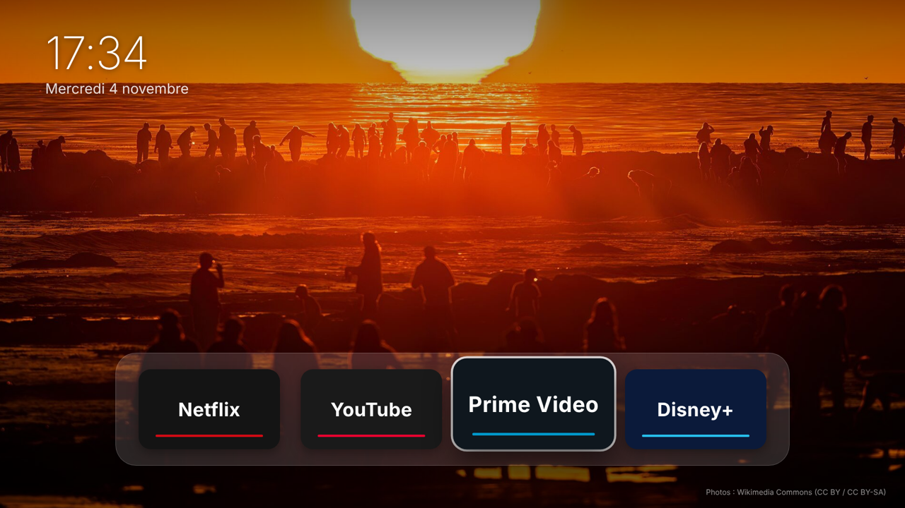

# Alléger une télé Samsung (Tizen) + écran d'accueil façon Apple TV

> Les télés Samsung tournent sous **Tizen**, pas Android TV : pas d'ADB, impossible de
> désactiver les applis système ou de remplacer le lanceur d'origine. Ce kit fait le
> maximum possible, de façon **100 % réversible** et sans rien désinstaller du système.

Tes choix : dock **Netflix, YouTube, Prime Video, Disney+** ; tu n'utilises **ni**
l'assistant vocal, ni le tuner/chaînes, ni les applis du fabricant (Samsung TV Plus…).

## 0. Sauvegarde (avant toute chose)

Sur un ordinateur branché au même Wi-Fi que la télé (macOS ou Linux ; sous Windows, via WSL) :

```bash
cd samsung-tv/scripts
./trouver-tele.sh              # affiche l'IP et le modèle de la télé
./sauvegarde.sh 192.168.1.42   # remplace par l'IP trouvée
```
Remplis `sauvegarde-…/reglages-avant.txt` et **photographie chaque écran de réglage
avant de le modifier**. Tizen ne permet pas de faire des captures d'écran à distance.

## 1. Pubs et télémétrie (réglages, réversibles)

Les chemins varient un peu selon l'année du modèle.

| Où | Réglage | Valeur |
|---|---|---|
| Paramètres → Assistance (ou Général) → Conditions et confidentialité → Confidentialité | Informations de visionnage (ACR : télémétrie de ce que tu regardes) | **Désactivé** |
| idem | Publicités basées sur les centres d'intérêt | **Désactivé** |
| idem | Service de reconnaissance vocale | **Désactivé** |
| idem → Conditions générales | Conditions facultatives (marketing, Samsung TV Plus…) | **Décochées** |
| Paramètres → Général → Fonctions Smart | Exécution auto du Smart Hub | **Désactivé** |
| idem | Lancer automatiquement la dernière appli | **Désactivé** |
| Paramètres → Assistance → Entretien de l'appareil | Optimiser | Lancer |

**Applis inutiles :** sur l'accueil, appui long sur l'appli (Samsung TV Plus, Gaming Hub,
Samsung Health, Art Store…) puis **Retirer** ou **Supprimer**. Les applis système sont
seulement masquées et reviennent via la boutique Apps si besoin.

**Pubs restantes (bannières de l'accueil) :** utilise un DNS filtrant, réversible en
remettant le DNS en « automatique ». Va dans Paramètres → Général → Réseau → État du
réseau → Paramètres IP → DNS manuel, avec par exemple `94.140.14.14` (AdGuard DNS), ou
NextDNS / Pi-hole en bloquant :
```
samsungads.com
ad.samsungadhub.com
samsungacr.com
```
Si une appli que tu utilises ne marche plus, retire le domaine concerné ou remets le DNS
en automatique.

## 2. Écran d'accueil « Accueil »



Horloge, dock de 4 applis (flèches ← → puis OK), 6 photos nature qui se succèdent en
fondu toutes les 45 s, dock qui s'estompe après 12 s d'inactivité. Tout se règle dans
`home-app/apps.js`.

Installation (une seule fois) :
1. Installe **Tizen Studio** et, dans le Package Manager, l'extension **Samsung TV**.
2. Dans **Certificate Manager**, crée un profil de certificat **Samsung** (compte Samsung requis).
3. Sur la télé : **Applis**, tape `1 2 3 4 5` sur la télécommande, active le
   **mode développeur**, entre l'IP de ton ordinateur et redémarre la télé.
4. `./installer.sh IP_TELE NOM_DU_PROFIL`
5. Sur la télé, déplace « Accueil » en **première position** de la barre d'applis.

Limites : Tizen ne permet pas de remplacer l'accueil Samsung. « Accueil » s'ouvre
comme une appli, à placer en tête de barre. Les applis développeur peuvent être
retirées après un certain temps ; il suffit alors de relancer `installer.sh`.

## 3. Tout restaurer

```bash
./restaurer.sh IP_TELE
```
Le script désinstalle « Accueil », affiche les valeurs d'origine notées dans la
sauvegarde pour remettre chaque réglage, et rappelle comment couper le mode développeur.
Pour le DNS, remets-le en « automatique ».
